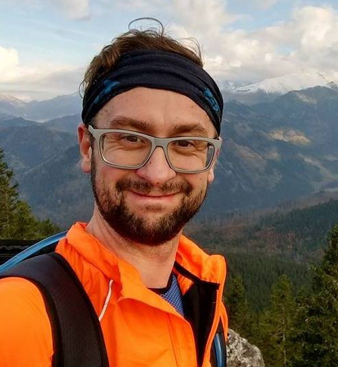

:::::::: {.concept-home}
:::::: {.home-hero}
::::: {.home-shell .home-hero-layout}
:::: {.home-hero-copy}
[Computational cosmology · Warsaw, Poland]{.home-kicker}

# Understanding [the dark Universe]{.home-hero-title-line}

[I investigate the fundamental physics of the dark Universe through the formation, evolution and dynamics of cosmic structure — combining numerical simulations, theoretical modelling and statistical methods.]{.home-lead}

::: {.home-role}
**Prof. Wojciech A. Hellwing**\
Head of the Computational Cosmology Group\
, Warsaw
:::

::: {.home-actions}
[Explore my research](#research){.home-button .home-button-primary} [Publications](publications.qmd){.home-button} [CV (PDF)](assets/W_Hellwing_CV.pdf){.home-button}
:::
::::

{.home-portrait fig-alt="Portrait of Wojciech A. Hellwing" width="488" height="529" fetchpriority="high"}
:::::
::::::

:::: {.home-identity}
::: {.home-shell .home-identity-layout}
Gravity · Dark matter · The Cosmic Web

[ORCID](https://orcid.org/) [NASA ADS](https://ui.adsabs.harvard.edu/search/q=orcid%3A) [Google Scholar]() [GitHub]()
:::
::::

:::::: {.home-section}
::::: {.home-shell}
:::: {#research .home-section-head}
::: {.home-section-title}
[Scientific programme]{.home-kicker}

## Three questions about the Universe.
:::

::: {.home-section-aside}
From the motion of galaxies to the smallest dark-matter structures, my research connects fundamental physics to astronomical observables. [Research overview](research.qmd)
:::
::::

:::: {.home-three .home-pillars}
::: {.home-pillar}
### Gravity & cosmic dynamics

Can the motions of galaxies and the growth of cosmic structure reveal departures from General Relativity? We develop velocity and higher-order statistical probes of gravity.

[Explore dynamics](research.qmd#novel-statistics){.home-link}
:::

::: {.home-pillar}
### Dark matter & galaxy formation

How does the nature of dark matter shape haloes, dwarf galaxies, satellites and stellar streams? High-resolution simulations connect particle physics to the small-scale Universe.

[Explore structure](research.qmd#simulation-campaigns){.home-link}
:::

::: {.home-pillar}
### The Cosmic Web

How do filaments, knots, sheets and voids influence galaxies and their haloes? We develop physical classification methods and use environment as a source of cosmological information.

[Explore environment](research.qmd#cosmic-web){.home-link}
:::
::::

::: {.home-foundation}
### Our shared foundation

Numerical simulations · scientific software · high-performance computing · statistical inference
:::
:::::
::::::

:::::: {.home-section .home-contributions}
::::: {.home-shell}
:::: {#contributions .home-section-head}
::: {.home-section-title}
[Selected scientific contributions]{.home-kicker}

## From methods to discoveries.
:::

[Complete publication record](publications.qmd){.home-link}
::::

:::: {.home-three .home-papers}
::: {.home-paper}
[Drozda et al. · 2025]{.home-kicker}

### Anisotropic counts-in-cells

A higher-order approach to cosmological constraints from redshift-space galaxy clustering.

[Physical Review D **112**, 063543](https://doi.org/10.1103/71cc-223l) · [Bibliography entry](publications.qmd#ref-2025arXiv250601762D){aria-label="Bibliography entry for Drozda et al. (2025)"}
:::

::: {.home-paper}
[Hellwing et al. · 2016]{.home-kicker}

### Copernicus Complexio

A high-resolution simulation programme for studying the small-scale structure of the Universe.

[MNRAS **457**, 3492–3509](https://doi.org/10.1093/mnras/stw214) · [Bibliography entry](publications.qmd#ref-2016MNRAS.457.3492H){aria-label="Bibliography entry for Hellwing et al. (2016)"}
:::

::: {.home-paper}
[Hellwing et al. · 2021]{.home-kicker}

### Caught in the Cosmic Web

How halo concentration, shape and spin depend on their large-scale cosmic environment.

[Physical Review D **103**, 063517](https://doi.org/10.1103/PhysRevD.103.063517) · [Bibliography entry](publications.qmd#ref-2021PhRvD.103f3517H){aria-label="Bibliography entry for Hellwing et al. (2021)"}
:::
::::

::: {.home-related}
**Related contribution** · [Jaber et al. (2024), pairwise motions in ΛCDM and modified gravity](https://doi.org/10.1103/PhysRevD.109.123528) · [Bibliography entry](publications.qmd#ref-2024PhRvD.109l3528J){aria-label="Bibliography entry for Jaber et al. (2024)"}
:::
:::::
::::::

:::::: {.home-section}
::::: {.home-shell}
:::: {#projects .home-section-head}
::: {.home-section-title}
[Research leadership]{.home-kicker}

## A connected research programme.
:::

::: {.home-section-aside}
Selected funded projects in numerical cosmology, gravity and the cosmic environment.
:::
::::

:::: {.home-three .home-projects}
::: {.home-project}
[NCN · SONATA BIS]{.home-kicker}

### VErTIGO

Galaxy velocity statistics and complementary tests of gravity.
:::

::: {.home-project}
[NCN / DFG · BEETHOVEN]{.home-kicker}

### LUSTRE

Constrained Local-Universe simulations and alternative gravity models.
:::

::: {.home-project}
[NCN · OPUS]{.home-kicker}

### COLAB

Cosmic-web environments and dark matter.
:::
::::

[View the official NCN project record](https://projekty.ncn.gov.pl/en/?kierownik_id=192){.home-link}

:::: {.home-lower}
::: {.home-detail}
[People & collaboration]{.home-kicker}

## Computational Cosmology Group {#people}

Our group at CFT PAN brings together numerical cosmology, theoretical modelling and analysis for galaxy surveys.

[Institutional group page](https://www.cft.edu.pl/en/grupa-naukowa/computational-cosmology/) · [Supervision](supervision.qmd)
:::

::: {.home-detail}
[Academic profile]{.home-kicker}

## From Durham and Portsmouth to Warsaw {#profile}

After research appointments in Durham and Portsmouth and a Marie Skłodowska-Curie Individual Fellowship, I established an independent research programme in Warsaw.

[Academic CV](cv.qmd)
:::

::: {.home-detail}
[Science beyond academia]{.home-kicker}

## Cosmology for everyone {#outreach}

Public lectures, educational initiatives and science communication.

[Watch the CosmoVerse Kraków talk on YouTube](https://www.youtube.com/watch?v=XQ7lCcKRS9U) · [News](news.qmd) · [Teaching](teaching.qmd)
:::

::: {.home-detail}
[Computational resources]{.home-kicker}

## Simulations, software & data {#resources}

Numerical experiments and reproducible analysis tools underpin the research programme.

[Software](software.qmd) · [Data](data.qmd)
:::
::::
:::::
::::::
::::::::
