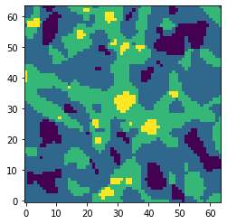
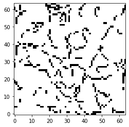

:::::::: {.research-page}
:::: {.research-hero}
::: {.research-shell}

[Research]{.research-kicker}

# Fundamental physics through cosmic structure

My research asks how the formation and dynamics of cosmic structure can reveal the fundamental properties of the Universe. We use cosmological simulations, physical modelling and statistical analysis to test gravity, investigate dark matter and understand how the cosmic environment shapes galaxies.

:::
::::

```{=html}
<nav class="research-index" aria-label="On this page">
  <ul class="research-shell">
    <li><a href="#novel-statistics">Gravity and dynamics</a></li>
    <li><a href="#simulation-campaigns">Dark matter and galaxies</a></li>
    <li><a href="#cosmic-web">The Cosmic Web</a></li>
    <li><a href="#computational-foundation">Computational foundation</a></li>
  </ul>
</nav>
```

:::::: {.research-band}
::::: {.research-shell}

## Gravity and the dynamics of cosmic structure {#novel-statistics .research-pillar}

:::: {.research-details}

[Can galaxy motions and the growth of structure reveal departures from general relativity?]{.research-question}

Galaxies and dark matter carry an imprint of the gravitational forces that shaped their distribution. Velocity statistics and higher-order clustering complement measurements of cosmic expansion and two-point clustering. We study these observables in the nonlinear regime, where astrophysical effects can also influence the signals.

### Galaxy velocities as tests of gravity

In simulations, low-order pairwise velocity statistics were sensitive to the modified-gravity models tested, particularly the projected line-of-sight pairwise velocity dispersion. Later work modelled mean pairwise infall by solving the pair-conservation equation with nonlinear power-spectrum inputs and tested the model against simulations in standard and modified gravity cosmologies.

[Hellwing et al. (2014), Phys. Rev. Lett. 112, 221102](https://doi.org/10.1103/PhysRevLett.112.221102) · [Jaber et al. (2024), Phys. Rev. D 109, 123528](https://doi.org/10.1103/PhysRevD.109.123528)

### Higher-order clustering and anisotropic counts-in-cells

Counts-in-cells measure how matter or galaxies are distributed within chosen volumes. The skewness of those counts carries information beyond two-point clustering. We investigated reduced skewness in real and redshift space, then used ellipsoidal cells to study how redshift-space anisotropy responds to cosmological parameters in simulations.

- [Drozda et al. (2025), Phys. Rev. D 112, 063546](https://doi.org/10.1103/4sxk-z8z4) · [Skewness preprint record](publications.qmd#ref-2025arXiv250412820D)
- [Drozda et al. (2025), Phys. Rev. D 112, 063543](https://doi.org/10.1103/71cc-223l) · [Anisotropic counts-in-cells preprint record](publications.qmd#ref-2025arXiv250601762D)

### Simulating the observed local Universe

We used positions and peculiar velocities from CosmicFlows-2 to construct initial conditions for simulations of the nearby Universe. The study demonstrated the method in Hu–Sawicki f(R) and normal-branch Dvali–Gabadadze–Porrati (nDGP) gravity. It makes it possible to compare different gravity models in simulations constrained by the observed local environment.

[Naidoo et al. (2023), Phys. Rev. D 107, 043533](https://doi.org/10.1103/PhysRevD.107.043533)

::: {.research-selected}

### Other selected work

- Nonlinear matter power spectrum · [Gupta et al. (2023), Phys. Rev. D 107, 083525](https://doi.org/10.1103/PhysRevD.107.083525)
- Halo mass-function universality · [Gupta et al. (2022), Phys. Rev. D 105, 043538](https://doi.org/10.1103/PhysRevD.105.043538)
- Tracer bias and selection in redshift-space distortions · [García-Farieta et al. (2021), Phys. Rev. D 103, 103524](https://doi.org/10.1103/PhysRevD.103.103524)
- Baryonic effects on matter density and velocity statistics · [Hellwing et al. (2016), MNRAS Letters 461, L11–L15](https://doi.org/10.1093/mnrasl/slw081)
- Testing a dark matter scenario in the context of cosmological tensions · [Naidoo et al. (2024), Phys. Rev. D 109, 083511](https://doi.org/10.1103/PhysRevD.109.083511)

:::
::::
:::::
::::::

:::::: {.research-band}
::::: {.research-shell}

## Dark matter and galaxy formation {#simulation-campaigns .research-pillar}

:::: {.research-details}

[What can the smallest cosmic structures tell us about the nature of dark matter?]{.research-question}

The properties of dark matter affect how small-scale density fluctuations grow into haloes and subhaloes, with consequences for dwarf galaxies, satellites and stellar streams. High-resolution simulations let us compare dark matter models and investigate how their predicted structures relate to observable galaxies.

### Copernicus Complexio

The Copernicus Complexio (COCO) N-body simulation resolved the formation of dark matter haloes and their substructure in a high-resolution region embedded in a larger cosmological volume. The particle mass in that region was about 1.135 × 10⁵ h⁻¹ solar masses. Subsequent COCO simulations compared cold dark matter with a warm dark matter scenario and investigated differences in subhalo abundance, internal structure and galaxy populations.

[Hellwing et al. (2016), MNRAS 457, 3492–3509](https://doi.org/10.1093/mnras/stw214) · [Bose et al. (2017), MNRAS 464, 4520–4533](https://doi.org/10.1093/mnras/stw2686)

### Halo assembly and concentration

We used the mass contained in a halo’s progenitors to relate its assembly history to its internal concentration in cold and warm dark matter simulations. The model accounts for differences in the concentration–mass relation, including the turnover in the warm dark matter case studied.

[Ludlow et al. (2016), MNRAS 460, 1214–1232](https://doi.org/10.1093/mnras/stw1046)

### Building a dwarf galaxy’s stellar halo through mergers

The ghostly-galaxies study modelled a possible formation channel in which stars form in a low-mass halo’s smaller progenitors. Mergers then assemble an extended stellar halo with little or no star formation in the central progenitor.

[Wang et al. (2023), Astrophys. J. 958, 166](https://doi.org/10.3847/1538-4357/ad011d)

::: {.research-selected}

### Other selected work

- Satellite distributions and gaps in stellar streams · [Lovell et al. (2021), MNRAS 507, 4826–4839](https://doi.org/10.1093/mnras/stab2452)
- Local Group star-formation histories in alternative dark matter scenarios · [Lovell et al. (2020), MNRAS 498, 702–717](https://doi.org/10.1093/mnras/staa2525)
- Accreted stellar haloes around dwarf galaxies · [Deason et al. (2022), MNRAS 511, 4044–4059](https://doi.org/10.1093/mnras/stab3524)

:::
::::
:::::
::::::

:::::: {.research-band}
::::: {.research-shell}

## The Cosmic Web and environmental cosmology {#cosmic-web .research-pillar}

:::: {.research-details}

[How does the cosmic environment shape haloes and galaxies, and what can it reveal about cosmology?]{.research-question}

Cosmic structure forms a network of filaments, sheets, knots and voids. We study how these environments relate to halo formation, internal structure and galaxy properties. We also develop methods to measure the web’s geometry and dynamics in simulations and to guide the interpretation of observations.

### Classifying environments and tracing filaments

The V-web uses local velocity shear to classify environments. We studied a normalisation and a threshold that keeps the volume fractions of web environments approximately constant across the redshifts tested, with a prescription that accounts for redshift and smoothing scale. The complementary COsmic Web Skeleton (COWS) method uses thinning and connectivity analysis to trace individual filament spines from V-web structures.

[Olex et al. (2025), A&A 696, A142](https://doi.org/10.1051/0004-6361/202453376) · [Pfeifer et al. (2022), MNRAS 514, 470–479](https://doi.org/10.1093/mnras/stac1382)

```{=html}
<figure class="research-figure" id="cows-example">
  <div class="research-figure-panels">
    
    
  </div>
  <figcaption>
    <strong>From V-web classification to filament spines.</strong>
    The classified slice shows purple voids, blue sheets, green filaments and yellow knots. The second panel
    shows separated COWS spines projected through a 10-cell-thick slice centred at the same depth.
    Axes are grid-cell indices.
    <span class="research-figure-credit">
      Simon Pfeifer, <a href="https://github.com/SimonPfeifer/cows/blob/4c492af95522c8d668ea7aa6dc57b7843c9de929/docs/example.ipynb">COWS example notebook</a>
      · <a href="assets/science/cows-license.txt">BSD 3-Clause licence</a>
    </span>
  </figcaption>
</figure>
```

### Caught in the Cosmic Web

In simulations spanning six orders of magnitude in halo mass, we found that concentration and formation time were strongly associated with environment for low-mass haloes. Spin and shape showed weaker environmental trends.

[Hellwing et al. (2021), Phys. Rev. D 103, 063517](https://doi.org/10.1103/PhysRevD.103.063517)

### Environment as a cosmological probe

Persistent homology describes the topology of simulated subhalo distributions and offers a way to compare dark matter models. In separate modified-gravity simulations, we compared the matter density field and halo properties across web environments. Together, these studies ask which signatures can distinguish cosmological models in the presence of environmental effects.

[Cisewski-Kehe et al. (2022), Phys. Rev. D 106, 023521](https://doi.org/10.1103/PhysRevD.106.023521) · [Gupta et al. (2024), Phys. Rev. D 110, 083520](https://doi.org/10.1103/PhysRevD.110.083520)

::: {.research-selected}

### Other selected work

- Subhalo abundance and internal density profiles across web environments · [Markos Hunde et al. (2025), A&A 700, A65](https://doi.org/10.1051/0004-6361/202452246)
- Hierarchical structure of the cosmic web and galaxy properties · [Jaber et al. (2024), MNRAS 527, 4087–4099](https://doi.org/10.1093/mnras/stad3347)

:::
::::
:::::
::::::

::::: {.research-band .research-foundation}
:::: {.research-shell}

## Computational cosmology {#computational-foundation .research-pillar}

::: {.research-details}

Controlled numerical experiments underpin all three research directions. We use N-body simulations, analyses of hydrodynamical simulations, constrained initial conditions, web classification and statistical modelling to connect theoretical predictions to observables. Comparing simulations with different physical assumptions helps us identify signatures of cosmological models and assess the limits of individual statistics.

[Software](software.qmd) · [Data](data.qmd) · [Complete publication record](publications.qmd)

[COCO simulation paper](https://doi.org/10.1093/mnras/stw214) · [COWS classification paper](https://doi.org/10.1093/mnras/stac1382)

:::
::::
:::::
::::::::
